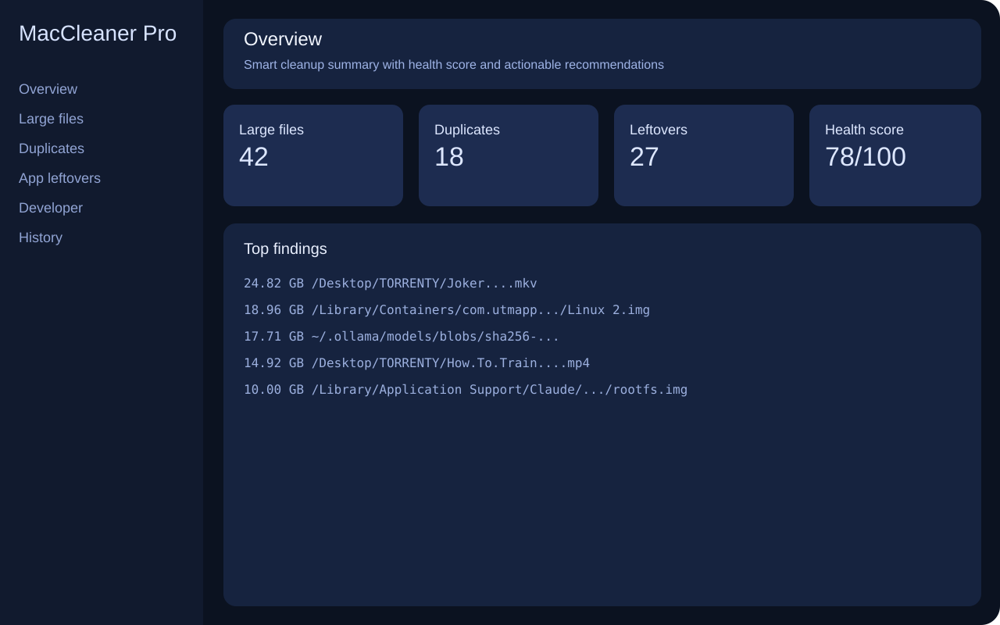
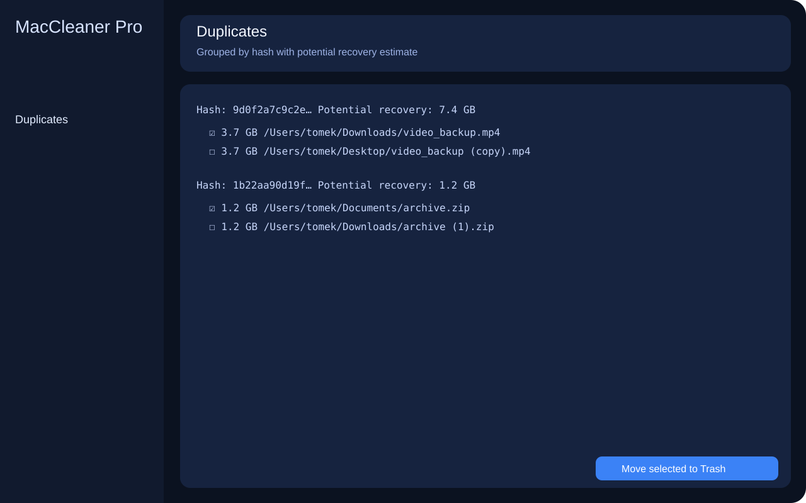

# MacCleaner Pro

Beautiful, native macOS cleaner app built with SwiftUI.

[](https://github.com/tomasztarlowski/maccleaner-pro/actions/workflows/ci.yml)
[](https://github.com/tomasztarlowski/maccleaner-pro/actions/workflows/release.yml)
[](LICENSE)

MacCleaner Pro helps you quickly find:
- large files,
- duplicate files,
- app leftovers,
- developer junk (Docker, Xcode, simulators, package caches).

It includes safe cleanup to Trash, scan history, profile-based scanning, report export, and bilingual UI (Polish/English).

## 🖼️ Screenshots

### Overview


### Duplicates


## ✨ Features

- **Native macOS UI** (SwiftUI)
- **Language switcher**: Polski / English
- **Cleanup profiles**: Cautious / Standard / Aggressive
- **Large file scanner** with configurable threshold
- **Duplicate scanner** with memory-safe limits
- **App leftovers scanner** (Library paths)
- **Developer junk scanner** (Docker/Xcode/cache-heavy paths)
- **Recommended selection** for fast cleanup
- **Export scan report** (`.txt`)
- **Scan history** (last 30 scans)
- **Safety first**: operations move files to **Trash**

## 🖥️ Requirements

- macOS 13+
- Apple Silicon / Intel
- Swift toolchain (for local builds)

## 🚀 Quick Start

### Build and run (debug)

```bash
swift build
swift run
```

### Build release app + DMG

```bash
./build_app.sh
```

Artifacts:
- `dist/MacCleaner Pro.app`
- `dist/MacCleaner Pro.dmg`

## 📦 Install

1. Open the latest DMG from Releases.
2. Drag **MacCleaner Pro.app** to Applications.
3. Launch from Applications.

## ⚠️ Known limitations

- Leftovers detection is heuristic-based and may produce false positives.
- Duplicate scan intentionally skips extremely large files in some edge cases for stability.
- Scanning huge disks can take time (progress/cancel UX improvements are planned).
- This app is currently unsigned/not notarized for App Store distribution.

## 🛡️ Safety notes

- Cleanup uses Trash, not permanent delete.
- Always review selected files before cleanup.
- For sensitive folders, use the **Cautious** profile.

## 🗺️ Changelog

See [CHANGELOG.md](CHANGELOG.md).

## 👥 Authors

- Tomek
- Jarvis

---
If you like the project, ⭐ the repo and share it.
